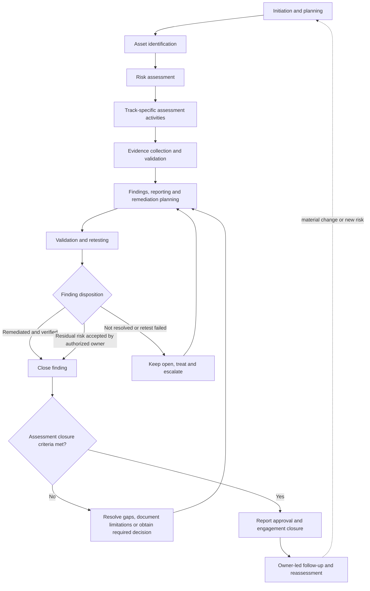

# Cybersecurity Assessment Lifecycle

> **Document type:** Operational lifecycle standard  
> **Status:** Initial version — adapt to organizational policy and context  
> **Maintainer:** Hussain Raza Naqvi  
> **Repository:** https://github.com/hussainraza110/Cybersecurity-Assessment-Governance-Framework

## 1. Purpose

This document defines a repeatable, risk-informed lifecycle for planning, conducting, reporting, and following up on cybersecurity assessments. It establishes common governance and quality controls while allowing different assessment types to use their own execution methods and evidence requirements.

The lifecycle is intended to be adaptable to individual practitioners, small teams, and enterprise or government organizations. It describes phase purposes, roles, activities, outputs, and exit criteria. Detailed technical instructions, risk-scoring rules, and evidence-handling procedures belong in their respective methodology or procedure documents.

## 2. Scope

The lifecycle supports six initial, composable assessment tracks:

1. Risk assessment
2. Vulnerability assessment
3. Configuration and security hardening review
4. Policy and control compliance assessment
5. Network and infrastructure security assessment
6. Application security assessment

An engagement may use one track or combine several tracks under a single approved scope and consolidated report. Track-specific activities, validation methods, and evidence requirements should be defined in the relevant procedures.

This document does not prescribe a universal risk-scoring formula, fixed remediation deadlines, assessment frequency, evidence-retention period, or organization-specific approval hierarchy. Those matters should be defined by the organization in accordance with its risk appetite, delegated authority, policies, legal and contractual obligations, and applicable standards.

## 3. Lifecycle at a glance

The diagram shows the principal flow, not a rigid sequence. Evidence gaps, failed quality gates, newly identified risks, scope changes, and retest results may require work to return to an earlier phase. Evidence collection and review may occur throughout the engagement.

## 4. Operating principles

- **Authorization first:** assessment activities must remain within documented authorization and approved scope.
- **Risk-informed:** assessment depth, validation, review, and follow-up should reflect risk, exposure, uncertainty, asset criticality, and applicable obligations.
- **Evidence-led:** findings should be traceable to relevant observations and supporting evidence.
- **Proportionate:** scale process formality and control depth to the engagement while retaining essential safeguards.
- **Transparent:** distinguish verified results from assumptions, limitations, exclusions, and inconclusive outcomes.
- **Accountable:** assign owners and target dates to remediation actions and record risk decisions.
- **Adaptable:** use organization-defined criteria and approval authorities where this document does not prescribe a universal rule.
- **Controlled:** document material changes and hold progression when required quality gates have not been met.

## 5. Roles and responsibilities

One person may perform multiple roles in a small engagement, provided conflicts and limitations are documented. Where risk or organizational requirements call for independent review, role consolidation should not be treated as equivalent to independent assurance.

| Role | Core responsibilities |
|---|---|
| Assessment lead | Coordinates planning, scope, execution, quality checks, reporting, and delivery; escalates issues and tracks required approvals. |
| Assessment team | Performs authorized activities, records observations, preserves relevant evidence, and documents methods and limitations. |
| Asset/system owner | Provides system context, validates asset information, coordinates operational access, and reviews findings affecting owned systems. |
| Risk owner | Owns risk decisions within delegated authority and documents acceptance of residual risk where authorized. |
| IT operations/remediation team | Implements agreed corrective actions and supplies evidence for validation and retesting. |
| Independent reviewer/auditor | Provides independent challenge or quality review where required by risk, policy, or the engagement plan. |
| Management/approving authority | Approves deliverables or exceptions where authorized and resolves escalations within delegated authority. |

Risk acceptance and assessment approval are distinct decisions. Approval of a report does not automatically accept residual risks or close all findings.

## 6. Initiation and authorization

### 6.1 Assessment triggers

An assessment may be initiated because of:

- A scheduled assessment cycle
- A new system or major system change
- An identified vulnerability or security incident
- A management or audit request
- A material change in business risk or threat exposure
- A regulatory or contractual requirement

### 6.2 Authorization requirements

Every assessment should have documented authorization before assessment activities begin. The depth and formality of approval should be proportionate to the risk and potential operational impact.

Recurring activities may operate under standing authorization when the activities, systems, boundaries, and restrictions are clearly covered by an approved program or rules of engagement. Changes outside that authorization require the applicable approval before proceeding.

Urgent assessments may use an expedited approval path, but authorization must be documented before testing begins. Urgency does not make authorization optional.

## 7. Planning and scope

The assessment lead should coordinate a documented assessment scope and plan. The relevant asset/system owner should participate in scope review. Risk-owner or management approval should be obtained where required by risk, delegated authority, or organizational policy.

### 7.1 Required scope-plan fields

The scope and plan should record:

1. Assessment objectives and type
2. In-scope assets, systems, and locations
3. Out-of-scope assets and exclusions
4. Assessment criteria and applicable standards
5. Permitted methods and testing restrictions
6. Roles, contacts, and escalation path
7. Schedule and maintenance windows
8. Expected deliverables and acceptance criteria

Additional fields may be included where needed, such as business impact, operational constraints, evidence-handling requirements, or specific approval records.

### 7.2 Scope changes and out-of-scope discoveries

A proposed change to scope or permitted methods should be documented, its impact assessed, and required authorization obtained before changed activities proceed.

If a potentially serious issue is discovered outside scope, the team should stop activity on the out-of-scope item, preserve permitted observations, and notify the designated authority for a scope decision. Discovering a vulnerability does not itself authorize further testing.

### Phase 1 — Planning and scope

| Element | Requirements |
|---|---|
| Purpose | Establish why the assessment is needed, what it covers, and under what authority it will be conducted. |
| Inputs | Assessment trigger, business context, existing asset information, applicable requirements, and relevant prior findings. |
| Key activities | Define objectives and track selection; identify stakeholders; establish scope and exclusions; define criteria, methods, schedule, deliverables, and escalation contacts; obtain required authorization. |
| Primary roles | Assessment lead, assessment team, asset/system owner; risk owner or management where required. |
| Outputs and records | Approved authorization; documented assessment scope and plan; agreed criteria, schedule, contacts, and deliverables. |
| Exit criteria | Objectives and boundaries are documented, required approvals are recorded, and the team understands permitted activities and restrictions. |

## 8. Asset identification

Identify the assets, systems, locations, and relevant dependencies included in the approved scope. Confirm ownership and criticality where this information is available and relevant to the assessment.

Asset discovery must remain within the approved scope and methods. If identification reveals assets or dependencies that may materially change the scope, document the discovery and seek a scope decision before assessing them.

### Phase 2 — Asset identification

| Element | Requirements |
|---|---|
| Purpose | Establish the assessment population and enough asset context to interpret results. |
| Inputs | Approved scope and plan, asset inventories, architecture information, and owner-provided context. |
| Key activities | Confirm in-scope assets and identifiers; identify relevant ownership, criticality, and dependencies; record discrepancies and unknowns; escalate material scope gaps. |
| Primary roles | Assessment team, assessment lead, asset/system owner. |
| Outputs and records | Confirmed or qualified asset list; asset-context notes; documented discrepancies and scope questions. |
| Exit criteria | The assessment team has a sufficiently defined assessment population, or remaining uncertainty and its impact are documented and accepted through the applicable process. |

## 9. Risk assessment

Identify relevant risk scenarios and assess likelihood, impact, existing controls, exposure, and other contextual factors appropriate to the assessment. Record assumptions and uncertainty. Use the organization's approved risk methodology and scoring model.

This lifecycle document does not define a numerical scoring formula or universal risk thresholds. See [Risk Assessment Methodology](risk-assessment-methodology.md) and [Risk Scoring Model](risk-scoring-model.md) when those documents are available.

### Phase 3 — Risk assessment

| Element | Requirements |
|---|---|
| Purpose | Establish an evidence-informed understanding of relevant risks and help determine assessment priorities. |
| Inputs | Confirmed asset context, business impact information, threat and vulnerability information, existing controls, and applicable criteria. |
| Key activities | Identify risk scenarios; analyze likelihood and impact; consider existing controls and exposure; document assumptions, uncertainty, and prioritization rationale. |
| Primary roles | Assessment team, assessment lead, asset/system owner, risk owner as appropriate. |
| Outputs and records | Risk observations or register entries; risk rationale; assumptions and unresolved information needs. |
| Exit criteria | Relevant risks are recorded at the level required by the assessment, with uncertainty and additional analysis needs identified. |

## 10. Track-specific assessment activities

Perform the activities required by the selected track or combination of tracks. Use only approved methods and remain within the agreed scope, schedule, operational constraints, and rules of engagement.

Potential activities vary by track and may include risk scenario analysis, vulnerability assessment, configuration and hardening review, policy and control review, network and infrastructure assessment, or application security testing. Detailed procedures and test instructions should be maintained separately.

### Phase 4 — Technical or track-specific assessment

| Element | Requirements |
|---|---|
| Purpose | Gather observations and evaluate the in-scope systems, controls, or risk scenarios using appropriate methods. |
| Inputs | Approved scope and plan, asset context, assessment criteria, selected tracks, and applicable procedures. |
| Key activities | Execute approved assessment activities; record methods and results; identify potential findings; observe operational constraints; escalate critical issues and unexpected instability. |
| Primary roles | Assessment team and assessment lead; asset/system owner and IT operations as needed. |
| Outputs and records | Activity records, observations, preliminary findings, test results, and documented deviations or limitations. |
| Exit criteria | Planned activities are completed or deviations are documented; potential findings and evidence needs are identified; material issues are escalated. |

## 11. Evidence collection and validation

Evidence collection and review may occur during every phase. Collect only information relevant to the authorized objectives and use approved storage and transfer methods.

Apply cryptographic hashes and stronger integrity controls where evidence sensitivity, criticality, or forensic requirements justify them. Maintain formal chain-of-custody records for retained evidence requiring traceability, including collection, transfers, material access, storage, and disposition. Follow organizational retention schedules, legal and contractual obligations, and investigation holds. Minimize sensitive collection, restrict access, and redact sensitive information in reports where appropriate.

Detailed evidence procedures will be maintained in [Evidence Handling](evidence-handling.md) when that document is available.

### Phase 5 — Evidence collection and validation

| Element | Requirements |
|---|---|
| Purpose | Ensure observations and findings have sufficient, relevant, traceable support for the decisions they inform. |
| Inputs | Assessment observations, tools and collection methods, evidence requirements, and applicable handling rules. |
| Key activities | Record source, context, and relevant timestamps; preserve evidence; apply integrity and access controls as appropriate; assess sufficiency and limitations; associate evidence with findings. |
| Primary roles | Assessment team, assessment lead, and reviewer where required. |
| Outputs and records | Evidence records and references; integrity records where applicable; finding-to-evidence traceability; documented evidence gaps. |
| Exit criteria | Evidence is sufficient for the intended conclusion, or uncertainty and limitations are clearly documented; sensitive evidence is handled appropriately. |

## 12. Findings, reporting, and remediation planning

Findings should be described in clear, testable terms and supported by evidence. Distinguish observed conditions from analysis, potential impact, assumptions, and recommendations. Apply contextual risk-based prioritization using the organization's approved criteria.

Validation depth and independence should be proportionate to risk, complexity, and uncertainty. Potentially critical issues should be promptly communicated to the designated contact. Pause relevant testing if needed, preserve permitted evidence, and follow the agreed escalation process.

### 12.1 Common finding record

Each finding should include, as applicable:

- Unique finding ID
- Description and supporting evidence
- Affected assets or controls
- Impact and likelihood assessment
- Risk rating and rationale
- Recommended remediation
- Responsible owner and target date
- Validation status and reviewer notes
- Residual risk and acceptance decision
- Retest results and closure evidence

### 12.2 Reporting requirements

The assessment report should include:

1. Executive summary
2. Objectives, scope, and assessment criteria
3. Methodology and activities performed
4. Coverage, exclusions, and limitations
5. Findings with evidence and risk rationale
6. Prioritized remediation plan
7. Residual risks and acceptance decisions
8. Conclusion and approval record
9. Assessment dates, participants, and roles

The report should support both management decisions and technical remediation. Distribution should be restricted to authorized recipients under organizational classification and distribution policy. Store sensitive evidence separately when including it in the report would create unnecessary exposure.

### Phase 6 — Reporting and remediation planning

| Element | Requirements |
|---|---|
| Purpose | Communicate results, prioritize findings, and establish accountable treatment actions. |
| Inputs | Validated findings, evidence records, risk analysis, assessment criteria, and stakeholder context. |
| Key activities | Review finding quality and risk rationale; prepare the report; agree on treatment options, owners, and target dates; document limitations, unresolved issues, and residual risk. |
| Primary roles | Assessment lead, assessment team, asset/system owner, risk owner, IT operations/remediation team, and reviewer as required. |
| Outputs and records | Assessment report; findings register; prioritized remediation plan; recorded review comments and required approvals. |
| Exit criteria | Findings are supported or qualified by documented limitations; actions have accountable owners where remediation is required; required review and reporting steps are completed. |

## 13. Validation and retesting

After remediation, validate whether the reported weakness or control gap has been addressed. Use methods appropriate to the finding and within the approved scope. Record the retest method, results, evidence, and remaining limitations.

A failed or inconclusive retest should not be recorded as successful remediation. Keep the finding open or apply another formally approved disposition.

### Phase 7 — Validation and retesting

| Element | Requirements |
|---|---|
| Purpose | Determine whether remediation is effective and whether the finding can be closed or needs further treatment. |
| Inputs | Finding record, agreed remediation action, remediation evidence, and authorized retest method. |
| Key activities | Review implementation evidence; perform approved retesting; compare results with closure criteria; document residual weaknesses and retest limitations. |
| Primary roles | Assessment team or designated validator, IT operations/remediation team, assessment lead, and reviewer where required. |
| Outputs and records | Retest results; validation status; updated finding record; closure evidence or further remediation actions. |
| Exit criteria | Remediation is verified, a failed/inconclusive result is documented for continued treatment, or another formally authorized disposition is recorded. |

## 14. Risk acceptance and finding closure

Risk treatment may involve:

- **Mitigate/remediate:** implement measures to reduce risk.
- **Avoid:** discontinue or change the activity that creates the risk.
- **Transfer/share:** allocate or share part of the risk through an appropriate arrangement.
- **Accept residual risk:** formally retain the remaining risk through an authorized decision.

Remediation deadlines should be defined by the organization based on risk, exposure, policy, and applicable obligations. A risk owner may accept residual risk within delegated authority; higher risks should be escalated as required. Acceptance should be explicit, documented, and subject to any applicable expiry or review conditions. A missed deadline or lack of response is not acceptance.

### Phase 8 — Risk acceptance and finding closure

| Element | Requirements |
|---|---|
| Purpose | Ensure findings are closed only through verified remediation or another formally approved disposition. |
| Inputs | Updated finding record, retest results, residual-risk analysis, treatment proposal, and delegated approval criteria. |
| Key activities | Confirm remediation evidence or review the proposed disposition; obtain authorized risk acceptance where applicable; document decision rationale, authority, conditions, and review date where relevant. |
| Primary roles | Risk owner, asset/system owner, assessment lead, management/approving authority where required. |
| Outputs and records | Closed finding with supporting evidence; or documented risk acceptance, approved alternative disposition, or continued open action. |
| Exit criteria | The finding meets the applicable closure criteria and the decision is traceable. Unresolved findings remain tracked with owners, treatment actions, and escalation as required. |

Assessment engagement closure and individual finding closure are separate decisions. An assessment may finish with open findings if their status, ownership, treatment, and escalation are documented appropriately.

## 15. Management approval, engagement closure, and follow-up

### 15.1 Assessment closure criteria

An assessment engagement may be considered for closure when:

- Approved scope has been completed or deviations are documented.
- The assessment report and findings register have been delivered.
- Evidence and assessment records have been stored appropriately.
- Limitations and unresolved issues are documented.
- Required review and approval have been completed.

The assessment lead and relevant asset/system owner should approve the final report, with management approval where required by policy or risk. Approval of the report does not automatically close every finding or accept all residual risks.

### Phase 9 — Management approval and follow-up

| Element | Requirements |
|---|---|
| Purpose | Confirm completion of the engagement, obtain required approvals, and maintain accountability for outstanding risks and actions. |
| Inputs | Final report, findings register, evidence records, limitations, outstanding actions, and required approval records. |
| Key activities | Review closure criteria; resolve documentation gaps or record approved exceptions; obtain required approvals; assign or confirm follow-up ownership; communicate outstanding risks. |
| Primary roles | Assessment lead, asset/system owner, risk owner, management/approving authority, and action owners as relevant. |
| Outputs and records | Approved report; engagement closure record; outstanding-action and risk follow-up records; documented approvals and exceptions. |
| Exit criteria | Required closure criteria and approvals are satisfied, and remaining findings and accepted risks have accountable owners and defined follow-up. |

### 15.2 Post-closure follow-up and reassessment

Accountable owners should continue tracking remediation and accepted risks after the assessment engagement closes. Periodic reviews and escalation should address overdue actions, changed risks, and any applicable acceptance conditions.

Assessment frequency should reflect asset criticality, risk, change rate, exposure, and applicable obligations. Reassessment should be considered when any of the following occurs:

- Material system or architecture change
- Significant new vulnerability or threat
- Security incident or suspected compromise
- Major change in risk or business impact
- Applicable regulatory or contractual change

## 16. Quality assurance and gate failures

Quality review should be proportionate to risk, complexity, uncertainty, and organizational requirements. Where one person performs the assessment, they should complete a documented self-review and record relevant limitations. Independent review should be obtained for high-risk or disputed findings where feasible and required by the engagement or organizational policy.

The following quality gates apply:

| Gate | Required check |
|---|---|
| Before execution | Scope and authorization are approved and documented. |
| Before reporting | Finding evidence and risk ratings have received the required validation. |
| Before finding closure | Remediation has been verified or another formally approved disposition is documented. |
| Before assessment closure | The final report and unresolved risks have received the required review. |

If a gate fails, progression should be held until the deficiency is resolved or a formally authorized exception is recorded. Unauthorized testing must stop immediately. An exception does not override applicable law, contractual obligations, or non-waivable organizational requirements.

If unexpected instability or an operational concern arises, pause the affected activity, escalate through the agreed path, preserve permitted evidence, and resume only when authorized and safe.

## 17. Coverage, limitations, and deviations

The report should distinguish between areas that were:

- **Assessed:** the planned activity was performed to the documented extent.
- **Partially assessed:** only part of the planned scope or procedure was completed.
- **Unassessed:** no assessment activity was performed for the area.
- **Excluded:** the area was explicitly excluded from the approved scope.
- **Inconclusive:** available evidence did not support a reliable conclusion.

For incomplete testing, missing evidence, access restrictions, or other limitations, document the cause, affected scope, impact on confidence, and recommended follow-up. An untested area must not be represented as having passed assessment.

Material deviations from the approved scope, method, or schedule should be recorded with their rationale, impact, required approvals, and resulting limitations.

## 18. Effectiveness measures

Organizations may track indicators covering both assessment delivery and security/risk outcomes. Suggested indicators include:

- Assessment plan and scope approved before execution
- Required assessment coverage achieved or deviations documented
- Findings supported by sufficient evidence
- Reports delivered within agreed timelines
- Remediation actions assigned to accountable owners
- Retests completed and results documented

Organizations should establish numeric targets appropriate to their context, risk appetite, obligations, and resources. Metrics should support improvement and transparency rather than incentivize suppression of findings or premature closure.

## 19. Records produced by the lifecycle

Depending on the assessment type and scope, records may include:

- Authorization and rules of engagement
- Assessment scope and plan
- Asset list and relevant context
- Risk assessment records and scoring rationale
- Activity logs and evidence register
- Finding register and supporting evidence references
- Assessment report and remediation plan
- Retest and validation records
- Risk acceptance and exception records
- Review, approval, and engagement closure records
- Follow-up actions and reassessment decisions

Records should be retained, protected, and disposed of in accordance with organizational requirements and the applicable evidence-handling process.

## 20. Related documents

The following documents are planned or maintained elsewhere in this repository:

- [Risk Assessment Methodology](risk-assessment-methodology.md)
- [Risk Scoring Model](risk-scoring-model.md)
- [Evidence Handling](evidence-handling.md)
- [Standards and Frameworks Reference Register](../../references/standards-and-frameworks.md)

Some linked methodology documents may not yet exist. They will be added and updated as the framework develops.

## 21. Limitations

This lifecycle is a general practitioner framework, not a substitute for organizational policy, legal or regulatory advice, or a formal certification assessment. Organizations should tailor roles, approval authorities, criteria, and records to their environment and obligations.

References to external standards or frameworks do not imply endorsement, official mapping, conformity, or certification. Technical activities must be authorized and remain within approved scope.
