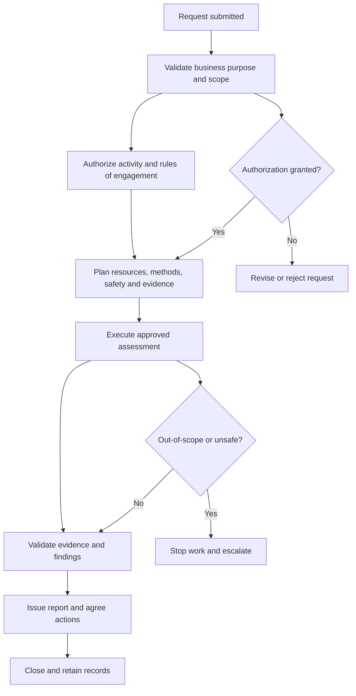

# Assessment Lifecycle Workflow

> **Implementation note:** This organization-neutral framework document must be tailored, reviewed, and approved before operational adoption. Replace bracketed fields and validate applicable legal, regulatory, contractual, and sector-specific requirements.

## 1. Purpose

This workflow maps the operational sequence for request → authorization → planning → execution → reporting → closure. It supplements, and does not replace, the governing policy, procedure, authorization, or risk decision.

## 2. Applicability and governing documents

Use this workflow only within approved organizational scope. Relevant governing documents include:

- `docs/policies/information-security-policy.md`
- `docs/procedures/security-assessment-authorization-procedure.md`
- `docs/procedures/security-incident-response-procedure.md`
- `docs/procedures/security-remediation-and-patch-management-procedure.md`
- `docs/methodology/risk-assessment-methodology.md`
- `docs/methodology/risk-scoring-model.md`
- `docs/methodology/evidence-handling.md`

The process owner must identify the specific subject policy and procedure applicable to the activity before use.

## 3. Inputs and prerequisites

- Approved request, business purpose, and scope.
- Identified assets, systems, records, stakeholders, and dependencies.
- Applicable criteria, policy requirements, and procedures.
- Assigned owner, competent personnel, and required access.
- Authorization, change approval, communications, and safety controls where required.

## 4. Workflow diagram

## 5. Process stages

### 1. Request submitted

**Expected output:** A recorded result, decision, or handoff sufficient to proceed to the next stage. If the stage fails, stop or return to the appropriate earlier stage and record the reason.

### 2. Validate business purpose and scope

**Expected output:** A recorded result, decision, or handoff sufficient to proceed to the next stage. If the stage fails, stop or return to the appropriate earlier stage and record the reason.

### 3. Authorize activity and rules of engagement

**Expected output:** A recorded result, decision, or handoff sufficient to proceed to the next stage. If the stage fails, stop or return to the appropriate earlier stage and record the reason.

### 4. Plan resources, methods, safety and evidence

**Expected output:** A recorded result, decision, or handoff sufficient to proceed to the next stage. If the stage fails, stop or return to the appropriate earlier stage and record the reason.

### 5. Execute approved assessment

**Expected output:** A recorded result, decision, or handoff sufficient to proceed to the next stage. If the stage fails, stop or return to the appropriate earlier stage and record the reason.

### 6. Validate evidence and findings

**Expected output:** A recorded result, decision, or handoff sufficient to proceed to the next stage. If the stage fails, stop or return to the appropriate earlier stage and record the reason.

### 7. Issue report and agree actions

**Expected output:** A recorded result, decision, or handoff sufficient to proceed to the next stage. If the stage fails, stop or return to the appropriate earlier stage and record the reason.

### 8. Close and retain records

**Expected output:** A recorded result, decision, or handoff sufficient to proceed to the next stage. If the stage fails, stop or return to the appropriate earlier stage and record the reason.

## 6. Decision points

- **Request complete?** Apply the governing procedure's criteria and record the decision, decision-maker, rationale, and evidence.
- **Authorization granted?** Apply the governing procedure's criteria and record the decision, decision-maker, rationale, and evidence.
- **Unexpected impact or out-of-scope activity?** Apply the governing procedure's criteria and record the decision, decision-maker, rationale, and evidence.
- **Findings require escalation?** Apply the governing procedure's criteria and record the decision, decision-maker, rationale, and evidence.

## 7. Roles and accountability

- **Process owner:** maintains the workflow and ensures process steps are implemented.
- **Business / service owner:** confirms business need, scope, dependencies, and operational impact.
- **Information Security:** advises on security requirements, risk, evidence, and escalation.
- **Technical / operational team:** executes assigned activities and records results.
- **Risk owner / approving authority:** makes risk decisions within delegated authority.

Specific role assignment must be documented for each execution. Workflow arrows do not themselves confer approval authority.

## 8. Outputs and records

Maintain the applicable request, authorization, assessment or activity record, decisions, evidence references, exceptions, risk treatment, notifications, and closure record. Protect records under the evidence-handling and retention requirements.

## 9. Exceptions and escalation

If scope, authorization, safety, integrity, or service availability is in doubt, pause the activity and escalate to the accountable owner. Suspected incidents must be handled under the Security Incident Response Procedure. Exceptions require documented risk assessment and authorized acceptance; workflow completion does not imply risk acceptance.

## 10. Review

The process owner must review this workflow with the governing procedure at least annually and after significant process changes, incidents, audit findings, or lessons learned.
